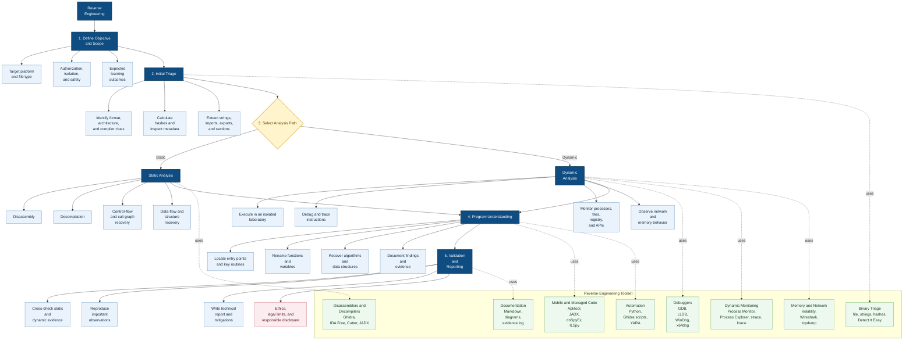

# **`Awesome`** Reverse Engineering Resources 

 

    
    &nbsp;
    
    &nbsp;
    
    

## 📖 Contents
- [Books](#books)
- [Videos](#videos)
- [My Other Awesome Lists](#my-other-awesome-lists)
- [Contributing](#contributing)
- [Contributors](#contributors)

### Learning Hub
* [FLARE Learning Hub](https://github.com/mandiant/flare-learning-hub)

### Books
* Intel
    * [Practical Reverse Engineering: x86, x64, ARM, Windows Kernel, Reversing Tools, and Obfuscation](https://www.amazon.com/Practical-Reverse-Engineering-Reversing-Obfuscation/dp/1118787315)
    * [Reversing: Secrets of Reverse Engineering](https://www.amazon.com/Reversing-Secrets-Engineering-Eldad-Eilam/dp/0764574817)
    * [x86 Software Reverse-Engineering, Cracking, and Counter-Measures](https://www.amazon.com/x86-Software-Reverse-Engineering-Cracking-Counter-Measures/dp/1394199880)
* ARM
    * [Blue Fox: Arm Assembly Internals and Reverse Engineering](https://www.amazon.com/Blue-Fox-Assembly-Internals-Analysis/dp/1119745306)

### Videos
* [RE//verse 2025: How to Find Fully-Remote Bugs with Reverse Engineering (Natalie Silvanovich)](https://youtu.be/UOr1F-Tx1Zg?si=wArIBp0JG87jfNZr)

#### Video Series
* [Introduction to Reverse Engineering by @olivestemlearning](https://youtube.com/playlist?list=PL2EF13wm-hWClpBrC4eCLD4NcdXiLsLEb&si=82sd9_0nFiSMJWms)

### CTF
* [The Flare-On Challenge](https://flare-on.com/)

### AI Reverse Engineering Agent
- [ReAgent](https://github.com/Dryxio/reagent)

##

### My Other Awesome Lists
You can access the my other awesome lists [here](https://cyberthreatdefence.com/my_awesome_lists)

### Contributing
[Contributions of any kind welcome, just follow the guidelines](contributing.md)!

### Contributors
[Thanks goes to these contributors](https://github.com/cybersecurity-dev/awesome-reverse-engineering-resources/graphs/contributors)!

### License

[🔼 Back to top](#awesome-reverse-engineering-resources-)
